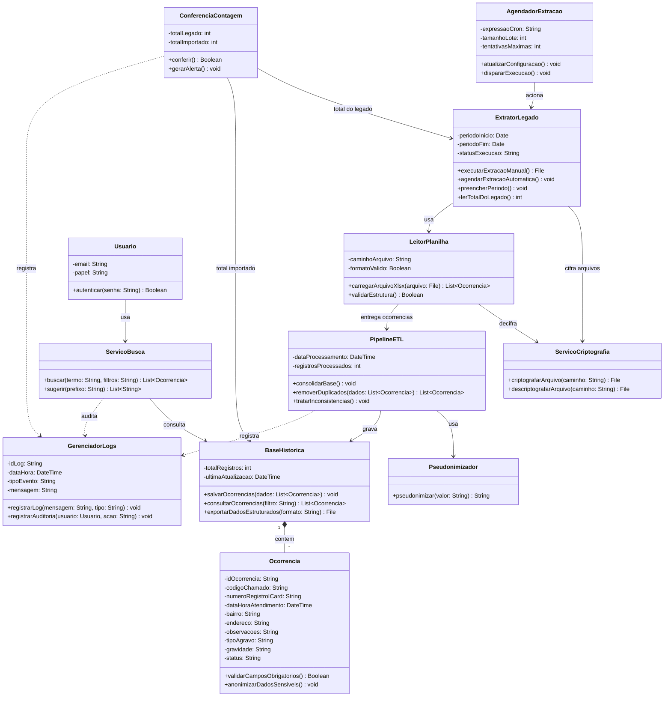

## Descrição

O SAMU DataFlow tem como objetivo automatizar a extração, consolidação e tratamento de dados das ocorrências do Serviço de Atendimento Móvel de Urgência (SAMU) do Recife. A solução visa substituir a necessidade de exportações manuais e fragmentadas em planilhas .xlsx, transformando dados isolados em uma base de dados histórica unificada, validada e pronta para análises epidemiológicas.

O sistema será desenvolvido aplicando os conceitos de Programação Orientada a Objetos em C#, fornecendo uma plataforma centralizada para os técnicos da saúde e para o Centro de Informações Estratégicas em Vigilância em Saúde (CIE).

## Objetivos do Projeto

* Aplicar os conceitos de Programação Orientada a Objetos (POO) em C#.
* Automatizar a leitura e consolidação de planilhas de ocorrências em formato .xlsx
* Identificar, tratar inconsistências e remover registros duplicados entre bases mensais.
* Registrar logs de execução e auditoria para monitoramento das rotinas de dados.
* Disponibilizar dados tratados para apoiar tomadas de decisão céleres e predições epidemiológicas pela SESAU/CIE.

## Tecnologias

- C# / .NET (ASP.NET Core Web API, Worker Service)
- Playwright para .NET (robô de extração)
- Entity Framework Core + PostgreSQL
- Quartz.NET (agendamento) e Serilog (logs)
- xUnit (testes)

 ## 🏗️ Diagrama de Classes (UML) Atualizado

